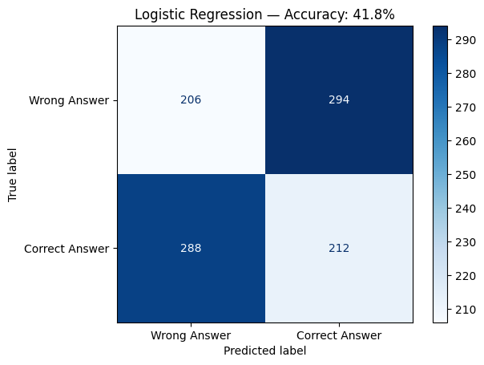

# Qwen3-14B LoRA Fine-Tuning: Reasoning Behaviour and Transfer

An exploratory study of how supervised fine-tuning changes the answers a language model produces: whether it finishes within a fixed output budget, attends to precise wording, repairs code coherently, and handles selected transfer prompts.

Two dataset experiments are described in the original report: **ORCA Math** for mathematical word problems and **Code-Feedback** for programming dialogue. Selected responses suggest improvements in answer completion and some task-specific checks, while a Python mutable-default-argument probe remains unresolved. These are qualitative observations from a course project, not a benchmark of general reasoning ability.

**Start here:** [training notebook](notebooks/qwen3_lora_finetuning.ipynb) · [experiment notes and all 20 probes](docs/experiment_notes.md)

## What the project investigates

- Can a short QLoRA training run change the usefulness of responses within a 512-token generation budget?
- How do mathematical wording and code-repair examples change after adaptation?
- Where do the observed improvements stop?

The report contains 10 mathematical and 10 programming prompts, each paired with a base and an adapted response. The supplied notebook preserves the **final Code-Feedback configuration**, the final mutable-default prompt, and a separate classical classification baseline. It does not preserve two fully runnable historical training configurations or an automated 20-prompt evaluation suite.

## Experiment at a glance

| Component | Recorded configuration |
| --- | --- |
| Base checkpoint | [`unsloth/qwen3-14b-unsloth-bnb-4bit`](https://huggingface.co/unsloth/Qwen3-14B-unsloth-bnb-4bit) |
| Adaptation | 4-bit QLoRA; NF4 and double quantization requested; bfloat16 model/compute dtype |
| LoRA | Rank 32, alpha 32; attention and MLP projection modules |
| Math dataset | [`HuggingFaceH4/orca-math-word-problems-200k`](https://huggingface.co/datasets/HuggingFaceH4/orca-math-word-problems-200k), described in the report |
| Code dataset | [`HuggingFaceH4/Code-Feedback`](https://huggingface.co/datasets/HuggingFaceH4/Code-Feedback), `train_sft`; 65,383 rows loaded in saved output |
| Saved code run | 88 optimizer steps; sequence length 2,048; batch size 1; gradient accumulation 4; learning rate `2e-4` |
| Generation | `max_new_tokens=512`; other decoding settings inherited from the checkpoint/library |
| Observed hardware | NVIDIA A100-SXM4-40GB; saved code-run time 376.29 seconds |

The number of loaded rows is not the number of examples processed in the short training run. Full settings, source discrepancies, and reproducibility limits are in the [experiment notes](docs/experiment_notes.md).

## Selected observations

| Probe | Base response in the report | Adapted response in the report |
| --- | --- | --- |
| Manuscript typing and revision costs | Ends before the final total | Completes the calculation: **$680** |
| Profit expressed as 20% of selling price | Answers **20%** of cost | Correctly answers **25%** of cost |
| Binary-search repair | Changes the upper bound but leaves an inconsistent algorithm | Supplies a coherent inclusive-bound implementation |
| VB.NET factorial | Supplies a program with negative-input handling | Supplies a similar program; an exploratory language-transfer example |
| Python mutable default argument | Repeats the code without explaining the output | Also repeats the code without explaining the output |

Some saved responses contain less visible repetitive deliberation after tuning. This supports a question about response behaviour, but does not establish an internal reasoning mechanism. The prompts were manually selected; overlap with training data or pretraining was not audited. The supplied materials do not include an execution-based test suite or recorded test results for generated programs.

## Classical baseline

The notebook also uses **TF-IDF (5,000 features) + logistic regression** to distinguish original math question–answer pairs from randomly mismatched pairs. The report records **41.8% accuracy**. The original notebook figure is preserved below; it is a historical artifact, not a new run.



This classifier solves a different task from the language model's answer generation. Its result is contextual evidence, not a head-to-head score. The saved code and report disagree on sample count; the code also fits TF-IDF before the split and leaves the split unseeded. These limitations are documented rather than silently corrected and presented as the original experiment.

## Using the notebook

Read the notebook on GitHub without installing anything. To run it, use a **Linux/CUDA notebook environment with a compatible NVIDIA GPU**; the recorded training used an A100 40GB. GPU memory requirements depend on the installed stack and runtime state.

```bash
git clone https://github.com/LokiLJ/qwen3-lora-reasoning-transfer.git
cd qwen3-lora-reasoning-transfer
python -m pip install -r requirements.txt
jupyter lab notebooks/qwen3_lora_finetuning.ipynb
```

Install a CUDA-compatible PyTorch build for your environment before installing the remaining requirements. Start with a fresh kernel and run the training and inference sections in order. The classical baseline section can be run separately without loading Qwen. Downloads require network access; model weights and datasets are not bundled.

The cleaned notebook saves adapters locally and disables automatic Hub uploads and remote experiment tracking. Credentials, if needed for downloads, belong in the runtime's secret store or normal Hugging Face login, never in committed cells. `requirements.txt` is an **unpinned dependency inventory**, because the original environment was not locked. Publication checks cover notebook structure, code syntax, configuration preservation, and sensitive-content review; GPU training has not been rerun for this release.

## Repository layout

```text
qwen3-lora-reasoning-transfer/
├── README.md
├── .gitignore
├── requirements.txt
├── notebooks/
│   └── qwen3_lora_finetuning.ipynb
├── docs/
│   └── experiment_notes.md
└── assets/
    └── baseline_confusion_matrix.png
```

## Origin and attribution

This project originated from an **MMA 606 course assignment**. The training notebook was adapted from the **course-provided starter workflow**, which itself cites the [Hugging Face TRL LoRA/QLoRA SFT notebook](https://github.com/huggingface/trl/blob/main/examples/notebooks/sft_trl_lora_qlora.ipynb). The report documents the author's dataset choices, configuration adaptations, prompt comparisons, classical baseline, and interpretation; it does not claim that the training framework was built from scratch.

This portfolio edition is based on the supplied `MMA_606_Assignment_4.ipynb` and `Assignment3.docx`. The original files remain unchanged outside this repository. See the [source record and cleanup log](docs/experiment_notes.md#source-record-and-publication-cleanup) for what was preserved and changed. Model, dataset, and upstream software terms remain applicable to their respective materials.
